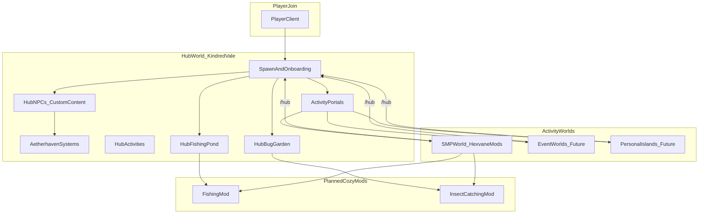

# KindredValeMod

Public-server infrastructure for **Kindred Vale** — a cozy Hytale community server by Hexvane.

*Animal Crossing / Stardew Valley vibes — a welcoming hub, meaningful activities, and optional personal islands.*

> **Status:** Early development. The plugin entry point exists but most features described here are **planned**, not yet implemented.

---

## Vision: Kindred Vale

Kindred Vale is a public Hytale server built around a cozy, low-pressure atmosphere. The goal is a place where players can decorate, socialize, explore, and progress at their own pace — inspired by games like **Animal Crossing** and **Stardew Valley**, not competitive minigame networks.

The server uses a **hub-and-spoke** world layout:

- **Hub world (`Kindred Vale`)** — The social heart of the server. NPCs, shops, portals to other worlds, and hub-only activities like fishing and bug catching. This is where players arrive, orient themselves, and return between sessions.
- **Activity worlds** — Separate destinations for deeper gameplay: an SMP world running Hexvane mods, future event/minigame worlds, and eventually personal islands.

Players install the full **mod pack** to join. **This repository** is the infrastructure plugin that wires the server together — routing, onboarding, permissions hooks, and hub utilities — not the content mods themselves.

### Mod ecosystem

| Mod | Role on Kindred Vale |
|-----|----------------------|
| **Aetherhaven** | Dialogue, quest, and NPC **systems** — runtime framework we build on (not a content pack we ship as-is) |
| **Wraith Busters** | Activity / gameplay content |
| **Mechanaria** | Exploration content |
| **Dragonlings** | Companion / cozy pet content |
| **KindredValeMod** (this repo) | Hub routing, onboarding, server rules UX, cross-world plumbing, future island system |
| **Fishing mod** *(planned)* | Cozy fishing — rods, seasonal catches, collection/selling loop |
| **Insect catching mod** *(planned)* | Cozy bug hunting — nets, rare spawns, museum-style collection |

Fishing and insect catching are **separate future mods**, not features of KindredValeMod itself — but they are central to the Kindred Vale identity and documented here as part of the overall server vision.

---

## What KindredValeMod is responsible for

Scope is defined explicitly so features do not bleed into sibling mods.

### In scope (this mod)

- Hub spawn flow and first-time player onboarding
- World/activity selection (portals, NPCs, commands, GUIs)
- Server-wide utilities: rules presentation, welcome messages, `[New]` tags, `/hub` return
- Cross-world player routing (leveraging Hytale's native `PlayerRef.referToServer()` — no third-party proxy needed)
- Permissions integration hooks (ranks, greylist/new-player tier)
- Future: personal island provisioning (AC-style private spaces, skyblock-inspired isolation)
- Config for which worlds exist and how players reach them

### Out of scope (sibling mods — engines)

| Concern | Owner |
|---------|-------|
| Dialogue UI, quest tracking, NPC interaction framework | **Aetherhaven** (use its systems; do not reimplement) |
| Fishing mechanics, fish species, rods, bait | **Fishing mod** *(planned)* |
| Insect spawns, nets, catch collection | **Insect catching mod** *(planned)* |
| New mobs, items, biomes, pets | Respective content mods |

### In scope for Kindred Vale content (this mod's assets)

- **Custom** hub NPC dialogue written for Kindred Vale (authored via Aetherhaven's dialogue format/API)
- **Custom** server quests — onboarding, dailies, seasonal events (authored via Aetherhaven's quest format/API)
- Hub-specific NPC placements and server lore — not Aetherhaven's default content

**Important:** We are **not** importing or reusing Aetherhaven's bundled quest/dialogue JSONs. We depend on Aetherhaven so we don't reinvent dialogue boxes, quest state, and NPC interaction — then author Kindred Vale-specific content on top.

The current plugin ([KindredValeModPlugin.java](src/main/java/com/hexvane/kindredvalemod/KindredValeModPlugin.java)) is a stub that logs on load. Everything else in this document describes **intent**.

---

## Architecture overview



### Hytale-specific notes

These matter if you have never hosted a public server before:

- **Native server transfers** — Hytale supports server-to-server player routing via `PlayerRef.referToServer(host, port)`. This can move players from hub to SMP without BungeeCord/Velocity-style proxy software.
- **Multiple worlds on one instance** — Community tools like [HyperVerse](https://github.com/HyperSystemsDev/HyperVerse) provide Multiverse-like world management within a single server process.
- **Multiple server instances** — Hytale's **server mesh** (`mesh.enabled` in `server.json`) is the native multi-node approach when load requires splitting backends.
- **Start simple** — Use a single instance with multiple worlds during early development. Split to mesh when SMP player count or tick load justifies the operational overhead.

---

## Dependency on Aetherhaven (framework, not content)

This is a common point of confusion, so it is spelled out here.

### What Aetherhaven provides (the engine)

- Dialogue presentation system (UI, branching, conditions)
- Quest system (objectives, progress tracking, rewards)
- NPC interaction plumbing (talk-to-NPC, trigger flows)

### What KindredValeMod provides (content + wiring)

- Kindred Vale-specific dialogue trees for hub greeters, shopkeepers, activity guides
- Server onboarding quests, daily/seasonal quests, event hooks
- Hub NPC placements and integration with world routing (e.g. quest step completes → unlock SMP portal)
- Assets under this mod's `Server/` folder — **custom content authored for this server**

### What we are NOT doing

- Reusing Aetherhaven's default/bundled quest or dialogue JSONs as our server narrative
- Building a parallel dialogue/quest framework from scratch in KindredValeMod

### Integration pattern

```
KindredValeMod (content + routing)  →  registers custom dialogue/quests
         ↓ uses API / data format of
Aetherhaven (systems)                 →  renders dialogue, tracks quest state
         ↓ triggered by
Hub NPCs                              →  player interaction
```

### Systems vs content

| Layer | Owner | Example |
|-------|-------|---------|
| Dialogue/quest runtime | Aetherhaven | Show dialogue box, track "catch 3 fish" progress |
| Server content | KindredValeMod | "Welcome to Kindred Vale!" greeter script, onboarding quest chain |
| World routing | KindredValeMod | Portal to SMP after tutorial quest completes |
| Activity mechanics | Fishing / Bug mods | Cast rod, swing net |

### Manifest dependency

Aetherhaven will be declared as a **required dependency** in [manifest.json](src/main/resources/manifest.json) once the integration contract is stable. Currently `"Dependencies": {}` is empty.

KindredValeMod handles *where* players go and *server infrastructure*. Aetherhaven handles *how* dialogue and quests run. KindredValeMod assets define *what* is said and *what* players are asked to do.

---

## Planned cozy activity mods *(not yet started)*

Two future Hexvane mods are central to the Kindred Vale daily loop. They are **not part of this repository** but are documented here because they shape hub design and server identity.

### Fishing mod *(planned)*

Inspired by **Animal Crossing** and **Stardew Valley** — relaxed, collection-driven, not combat fishing.

**Core loop**

- Equip a rod, cast into water, play a simple timing minigame to land the fish
- Sell catches for currency or donate to a collection (museum/bulletin board)
- Upgrade rods and unlock bait/lures over time

**Design pillars**

| Pillar | AC/Stardew inspiration | Kindred Vale adaptation |
|--------|------------------------|-------------------------|
| Seasonal spawns | Different fish by season, time, weather | Tie to server calendar / world season system |
| Location matters | River, ocean, pond, waterfall each have unique pools | Hub fishing pond + SMP biomes/water bodies |
| Shadow/size hints | Visual tell before hookset | Shadow size or splash VFX in Hytale water |
| Rarity excitement | Coelacanth-at-rain moments | Rare fish during storms or at night |
| Low pressure | No fail state beyond losing the catch | Gentle retry; no rod durability stress early on |

**Possible features (backlog)**

- Fish encyclopedia / catch log (first-catch notification)
- Daily "hot spot" or NPC fishing challenge (custom quest via Aetherhaven's quest system)
- Tournament mode (optional, seasonal hub event — keep opt-in)
- Aquarium display blocks for personal islands

**KindredValeMod integration**

- Hub fishing pond zone wired as a named fishing location
- Bulletin board showing today's seasonal catches (data from fishing mod API)
- Onboarding quest step: "catch your first fish" before SMP access (optional)

### Insect catching mod *(planned)*

Inspired by **Animal Crossing** bug catching — exploration, patience, and collection.

**Core loop**

- Equip a net, approach insects carefully, swing to catch
- Insects spawn on trees, flowers, rocks, water edges, and in the air depending on species
- Sell or donate to complete a collection; rare bugs require specific conditions

**Design pillars**

| Pillar | AC inspiration | Kindred Vale adaptation |
|--------|----------------|-------------------------|
| Spawn conditions | Time, season, weather, flower type | Per-biome and per-block-type spawn tables |
| Approach skill | Running scares bugs; slow creep required | Movement speed affects flee radius |
| Rarity tiers | Horned dynast, golden stag, etc. | Rare spawns on specific island/SMP nights |
| Collection reward | Museum exhibits, completion milestones | Hub display case or island trophy room |
| Hub-friendly | Catching around town is part of daily routine | Dedicated bug garden + SMP wild spawns |

**Possible features (backlog)**

- Bug encyclopedia with "first catch" and "donated" states
- Flee/escape VFX and audio (missed swing, stomped too close)
- Bug-Off seasonal event (hub leaderboard, optional — low competitive pressure)
- Display jars / frames for island decoration

**KindredValeMod integration**

- Hub bug garden as a curated spawn area for common species (tutorial-friendly)
- Seasonal bulletin: "Scarab beetles active this month"
- Collection milestone hooks — custom NPC dialogue when player donates N specimens (authored in KindredValeMod, rendered by Aetherhaven)

### Cross-mod cozy progression *(optional future)*

Fishing, bug catching, and custom hub quests can share a **daily routine** pattern:

1. Check the bulletin board
2. Fish at the hub pond
3. Catch bugs in the garden
4. Visit a shop or NPC
5. Return to SMP or personal island

KindredValeMod provides hub spaces, routing, and quest content. Aetherhaven runs the quest/dialogue systems. Activity mods own fishing and bug mechanics.

---

## Roadmap

Use this as a living tracker. Items marked **[done]** reflect current repo state; everything else is **planned**.

### Phase 0 — Foundation *(complete)*

- [x] Plugin scaffold, manifest, build pipeline
- [x] Document server vision (this README)

### Phase 1 — Hub MVP *(in progress)*

- [x] Hub spawn protection (no block break, no PvP)
- [ ] Clear navigation: labeled portals / NPC selectors to SMP world
- [ ] `/hub` command to return from activity worlds
- [ ] Short in-game rules + welcome flow (not a wall of signs)
- [ ] Discord link command/sign

### Phase 2 — Onboarding and retention *(planned)*

- [ ] First-visit tutorial quest — **custom Kindred Vale content** using Aetherhaven's quest system
- [ ] Custom greeter NPC dialogue (welcome, rules summary, hub tour)
- [ ] Starter kit or currency grant (quest reward or server command)
- [ ] `[New]` player tag visible to community
- [ ] Greylist rank: walk/chat in hub, full build access after tutorial completion or brief verification

### Phase 3 — Hub life and cozy activities *(planned)*

- [ ] Hub fishing pond (placeholder build until **Fishing mod** exists; then wire real mechanics)
- [ ] Hub bug garden / flower beds (placeholder until **Insect catching mod** exists)
- [ ] Daily bulletin board: seasonal catches, events, weather hints
- [ ] Photo spot, player build showcase area (staff-curated or vote-based)
- [ ] Event schedule board + Discord webhook for joins/milestones

### Phase 3b — Fishing mod *(separate repo, planned)*

- [ ] Rod item, cast/hook minigame, basic fish pool (hub pond + one SMP biome)
- [ ] Catch log, sell to shop NPC, 5–10 starter species
- [ ] Season/time/weather spawn tables

### Phase 3c — Insect catching mod *(separate repo, planned)*

- [ ] Net item, approach/flee behavior, swing-to-catch
- [ ] Spawn on flowers/trees/ground; hub bug garden + SMP wild spawns
- [ ] Catch log, donate/sell loop, 5–10 starter species

### Phase 4 — Personal islands *(planned)*

- [ ] Per-player isolated world/instance (skyblock-inspired, AC-themed)
- [ ] Visit friends' islands, hub return, starter template schematics
- [ ] Island settings GUI (visitors on/off, time/weather, permissions)
- [ ] Island fishing spots and bug habitats (personal cozy spaces)

### Phase 5 — Cozy depth *(planned)*

- [ ] Expanded fish/bug rosters, rare spawns, museum/display collections
- [ ] Seasonal Bug-Off / Fishing Tour events (opt-in, low pressure)
- [ ] Cross-mod daily quests — custom quest content in KindredValeMod ("catch 3 fish today"), tracked by Aetherhaven

---

## Hosting guidance

Lessons from established block-game networks (primarily Minecraft), adapted for Kindred Vale on Hytale. These are transferable principles, not a copy-paste of Minecraft plugin stacks.

### A. Network architecture

| Practice | Why it matters for Kindred Vale |
|----------|--------------------------------|
| Hub is a **router**, not a sandbox | Keep hub small, pre-built, low simulation load; gameplay happens in activity worlds |
| Isolate failure domains | SMP crash should not kick everyone; mesh/multi-instance helps at scale |
| Pre-generate hub terrain | Avoid chunk-gen lag on join spikes |
| Start single-instance, split later | Avoid over-engineering before you have players |

Large Minecraft networks (Hypixel-style) use a proxy in front of multiple backend servers. Hytale's native mesh and `referToServer()` reduce the need for third-party proxies, but the **hub-as-router** principle still applies: the hub should be lightweight and always available.

### B. Hub design (cozy-specific)

- **5-second rule** — New players should see all destinations immediately: color-coded paths, NPC pedestals, clear labels. If they cannot figure out where to go within five seconds, simplify.
- **Daily loop anchors** — The hub fishing pond and bug garden give players something to do *before* committing to SMP. This mirrors Animal Crossing's "check shops, fish, catch bugs" routine and gives returning players a reason to visit the hub even when they are not ready for a long SMP session.
- **Multi-use spaces** — One area can be social lounge + bulletin board + mini-market (Animal Crossing hotel lobby pattern). Cozy servers benefit from density of purpose, not sprawling empty builds.
- **Minimize tick load** — Avoid excessive entities, flowing water, and tick-heavy contraptions in the hub. Every millisecond counts when dozens of players load in simultaneously.
- **Adventure-mode feel** — Players cannot grief the cozy build. Building happens in SMP and on personal islands.
- **Modular expansion** — Leave buffer zones for future portals and event spaces without rebuilding the entire hub.

Keep the hub world small (roughly 200–400 blocks across). Pre-generate all chunks in the hub radius so the server never generates terrain on the fly during join spikes.

### C. Onboarding (retention-critical)

The first 30–60 seconds of a player's session largely determine whether they return.

- **Guided NPC quest beats a rules wall** — A greeter NPC with custom dialogue (via Aetherhaven) that walks the player through the hub is more effective than a dozen sign boards.
- **Short rules** — 5–7 core bullet points, posted in-game (book/sign), on Discord, and on a website if you have one.
- **Early win** — Currency, a tool, or a cosmetic within the first five minutes. Players should feel they accomplished something before logging off.
- **Discord as community home** — Link in spawn (`/discord` command or sign). Optional Discord role perks. Activity notifications (player joins, milestones) pull people back when they are not in-game.

Give new players a visible `[New]` tag so the community knows to welcome them.

### D. Governance and moderation

- **Simple rank ladder** — `Guest/Greylist → Member → Moderator → Admin`. Avoid fifteen-tier hierarchies that create drama and gatekeeping.
- **Greylist over full whitelist** — For a cozy public server, let new players explore the hub safely before granting full SMP build access. This stops bots and griefers without the application fatigue of a full whitelist.
- **Rollback/logging** — Have a plan for grief incidents before launch. Document an appeal process in plain language.
- **Moderate tone, not just blocks** — Consistent, predictable enforcement beats harsh mystery bans. Toxic chat tolerated by staff will keep the server small regardless of how good the build is.
- **Staff coverage** — Aim for 2+ moderators in your timezone and 1 in an opposing timezone (8–12 hours offset). Discord catches reports that happen at 3am when nobody is in-game.

A server with three moderators is dramatically more stable than a server with one, even if all three are less experienced.

### E. Economy (if used)

- Balance **faucets** (jobs, quests, selling fish/bugs) against **sinks** (shops, taxes, decor purchases) to prevent inflation.
- Players should be able to participate in the economy within their first hour.
- Prefer **cosmetic/support monetization** over pay-to-win if donations are ever considered. Transparent funding goals (hosting costs, development time) build trust.

Monitor the wealthiest players periodically. If top balances grow too fast, add sinks or reduce faucet rates.

### F. Island system *(future — skyblock/AC pattern)*

When personal islands are implemented:

- Isolated per-player instances with hub return (`/island home`, `/hub`)
- Multiple starter templates (cozy cottage, forest glade, beach)
- Visit permissions + island settings GUI
- Leaderboards optional — keep low-pressure for cozy identity

Study skyblock server patterns (BentoBox, SkyeBlock) for isolation and provisioning mechanics, but adapt the tone: islands are cozy retreats, not competitive grind zones.

### G. Pre-launch operations checklist

- [ ] Hub pre-generated and protected
- [ ] Permissions configured (guest vs member)
- [ ] Rules posted (in-game + Discord)
- [ ] Onboarding quest tested as a non-op player
- [ ] Backup strategy for SMP world
- [ ] Staff mod guide (what to do when someone griefs)
- [ ] Performance baseline: hub view distance low, SMP tuned separately

### Further reading

- [Astroworld hub guide](https://guide.astroworldmc.com/how-to-make-minecraft-server-hub) — Hub world design and performance tuning
- [Onboarding best practices](https://blogs.keystonebuilds.net/welcoming-onboarding-experience-for-new-players/) — First-visit player experience
- [Server governance patterns](https://guildorder.com/games/minecraft/guides/server-governance) — Whitelist/greylist, staff structure, rollback
- [Hytale server mesh docs](https://deepwiki.com/vulpeslab/hytale-docs/2.5-server-mesh-architecture) — Multi-server architecture on Hytale
- [HyperVerse multi-world plugin](https://github.com/HyperSystemsDev/HyperVerse) — Multiple worlds on a single Hytale instance

---

## Development

### Build

```bash
./gradlew build
```

The built plugin JAR will be in `build/libs/`.

### Run test server

```bash
./gradlew runServer
```

Assets modified in-game are synced back to `src/main/resources/` when the server stops. Use `./gradlew runServerNoSync` if you are editing source assets while testing.

### Configuration

If Hytale is installed in a non-standard location, set these properties globally in `%USERPROFILE%/.gradle/gradle.properties`:

```properties
hytale.install_dir=path/to/Hytale
hytale.decompile_partial=true
```

### Hub protection

Hub worlds are protected via ECS block events — players cannot break, place, or punch blocks. Staff with build permission can opt in to editing with `/hubbuild`. PvP is disabled on protected worlds by default.

**Config file:** `mods/hexvane/KindredValeMod/HubProtection.json` (written on first server start if missing)

```json
{
  "ProtectedWorlds": ["KindredVale"],
  "DisablePvpInProtectedWorlds": true
}
```

Add world names to `ProtectedWorlds` (case-insensitive) to match your hub world folder names.

**Staff permissions and build mode**

| Permission | Group | Effect |
|------------|-------|--------|
| `hexvane.kindredvalemod.hub.build` | `kindredvale:HubBuilder` | May use `/hubbuild` to edit protected hub worlds |
| `*` | `hytale:Admin` | Same — admins must toggle build mode on to edit |

Having build permission does not bypass protection by itself. Run `/hubbuild` in a protected hub world to enable editing for your session (`/hubbuild on`, `/hubbuild off`, or no argument to toggle). Build mode resets when you disconnect.

Add the hub builder group to server `permissions.json`:

```json
"kindredvale:HubBuilder": {
  "permissions": ["hexvane.kindredvalemod.hub.build"]
}
```

Assign builders with `/setgroup kindredvale:HubBuilder <player>`. Full admins in `hytale:Admin` have the permission via `*` but still use `/hubbuild` when editing the hub.

### Project layout

```
KindredValeMod/
├── src/main/java/com/hexvane/kindredvalemod/
│   ├── KindredValeModPlugin.java    # Plugin entry point
│   ├── config/                      # Plugin config codecs
│   ├── command/                     # Player commands (e.g. /hubbuild)
│   ├── hub/                         # Hub protection service + ECS systems
│   └── permissions/                 # Permission nodes and groups
├── src/main/resources/
│   ├── manifest.json                # Gradle property expansion
│   └── Server/                      # Game assets (NPCs, lang, hub content)
├── build.gradle.kts
└── gradle.properties
```

### Related repos

These mods live in the broader Hexvane Hytale modding workspace:

| Repo | Status |
|------|--------|
| Aetherhaven | Existing — dialogue/quest/NPC systems |
| Wraith Busters | Existing — activity content |
| Mechanaria | Existing — exploration content |
| Dragonlings | Existing — companion pets |
| Fishing mod | Planned |
| Insect catching mod | Planned |

---

## License

See [LICENSE.md](LICENSE.md).
